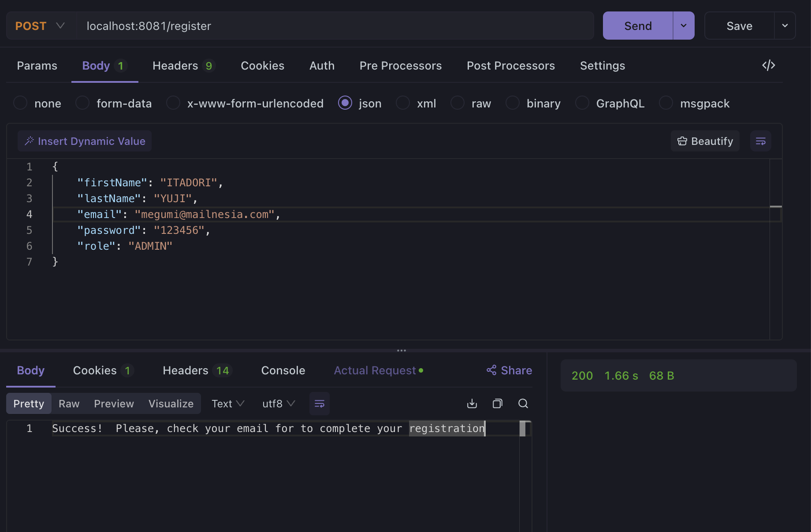
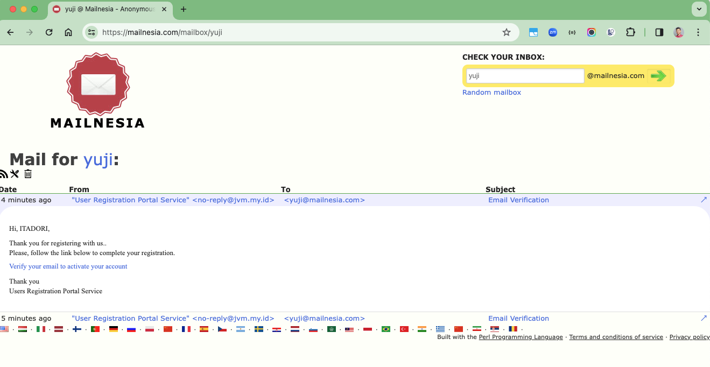
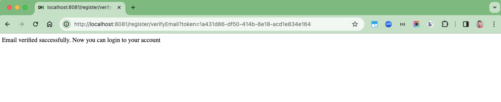
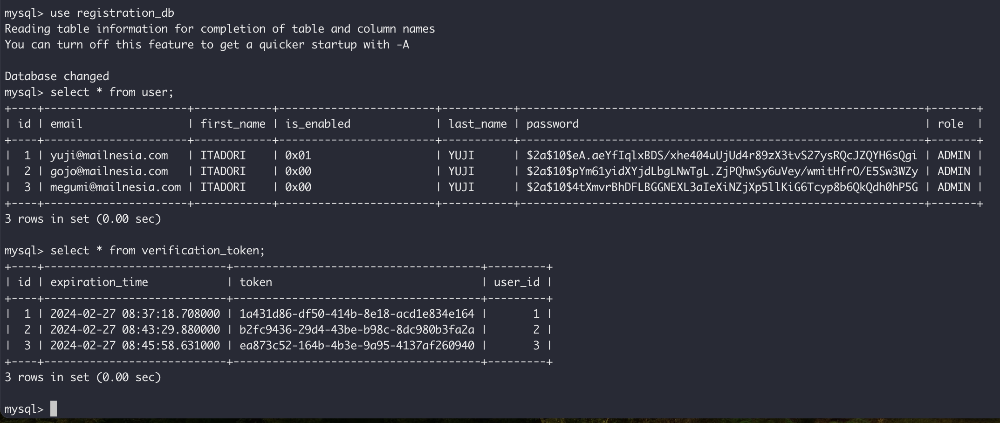

# spring-boot-email-verification-demo

[](https://github.com/hendisantika/spring-boot-email-verification-demo/actions/workflows/maven.yml)


User registration with e-mail verification built on Spring Boot. When a user registers, a verification token is
generated and a link is e-mailed to them. The account is enabled after the link is opened.

## Tech Stack

- Java 25 (Temurin)
- Spring Boot 4.1.x (Web MVC, Data JPA, Security 7, Mail, Docker Compose support)
- MySQL 9 (runtime) and H2 in-memory (tests)
- Lombok
- Maven Wrapper

## Prerequisites

- JDK 25
- Docker (for the MySQL container defined in `compose.yml`)
- An SMTP account (e.g. Gmail with an App Password)

## Getting Started

1. Clone this repository: `git clone https://github.com/hendisantika/spring-boot-email-verification-demo.git`
2. Navigate to the folder: `cd spring-boot-email-verification-demo`
3. Change the DB & SMTP e-mail credentials in `src/main/resources/application.yml`
4. Run the application: `./mvnw clean spring-boot:run`
   - `spring-boot-docker-compose` starts MySQL from `compose.yml` automatically (port `3307`).
5. Open an HTTP client (Postman, Insomnia, API Dog, or IntelliJ HTTP Client). The app runs on `http://localhost:8081`.

## API Endpoints

| Method | Endpoint                            | Access          | Description                              |
|--------|-------------------------------------|-----------------|------------------------------------------|
| POST   | `/register`                         | Public          | Register a new user & send verify e-mail |
| GET    | `/register/verifyEmail?token=<tok>` | Public          | Verify the user's e-mail                 |
| GET    | `/users`                            | `USER`, `ADMIN` | List users (form login)                  |

Add New User

```http
###
POST http://localhost:8081/register
Content-Type: application/json

{
  "firstName": "ITADORI",
  "lastName": "YUJI",
  "email": "yuji@yopmail.com",
  "password": "1234",
  "role": "ADMIN"
}
```

Verify E-Mail (link sent to the user's inbox)

```http
###
GET http://localhost:8081/register/verifyEmail?token=<verification-token>
```

## Running Tests

```shell
./mvnw clean verify
```

Tests use an H2 in-memory database (`src/test/resources/application.yml`), so no MySQL or Docker is needed.

## CI/CD & Dependency Updates

- **GitHub Actions** (`.github/workflows/maven.yml`): builds and tests with JDK 25 on every push / pull request to
  `main`, then submits the dependency graph for better Dependabot alerts.
- **Dependabot** (`.github/dependabot.yml`):
  - Maven: daily, grouped (`spring-boot`, `maven-plugins`, `minor-and-patch`)
  - GitHub Actions: weekly, grouped into a single PR
  - Docker Compose (`compose.yml`): weekly
  - Labels, assignee and conventional commit prefixes (`chore(deps)`, `ci(deps)`, `chore(docker)`)

## Image Screenshot

Send E-Mail API



Verification E-Mail



E-Mail Verified



Database State


